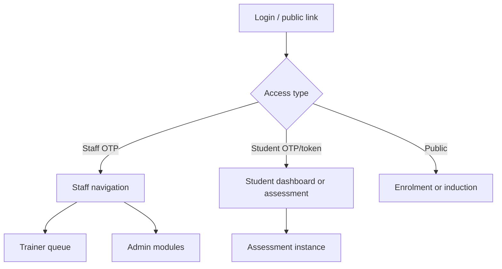
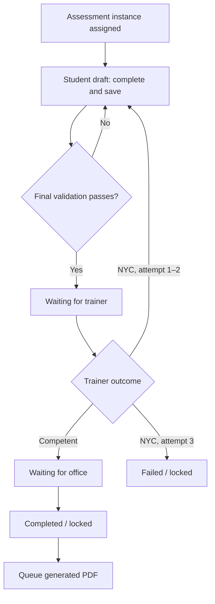
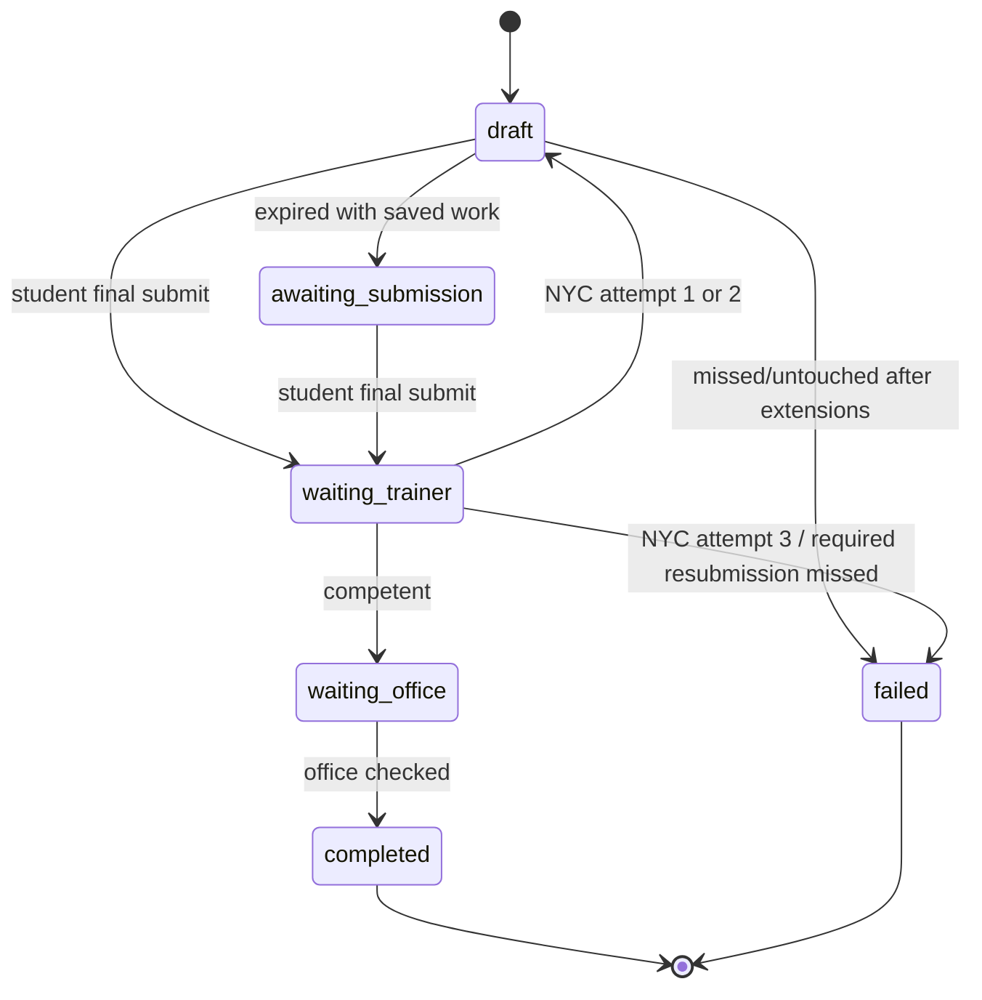
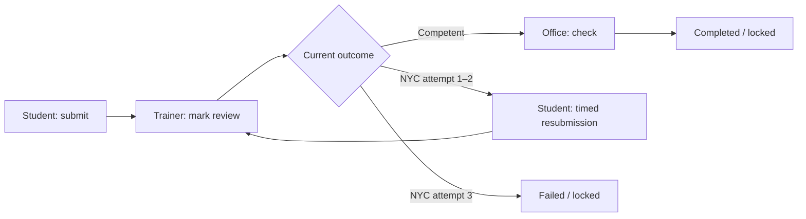
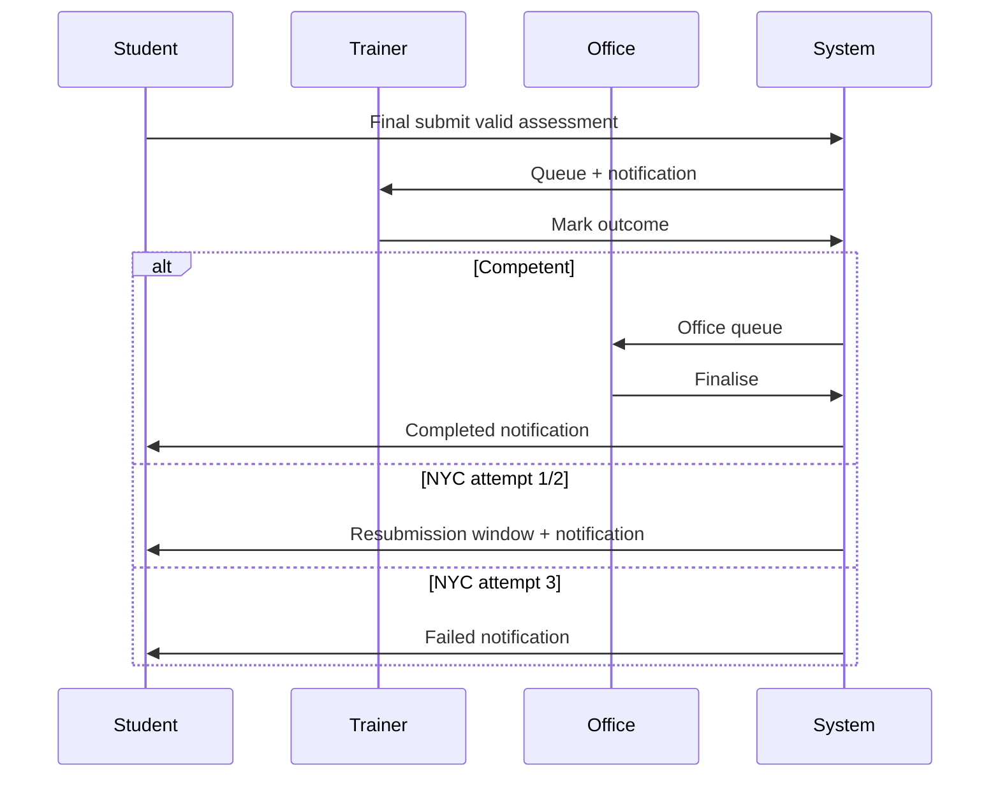

# Skyline Submissions — Process Flow

## 1. Document Purpose

This document describes the workflow implemented in the Skyline Submissions repository as inspected on 9 October 2026. It is intended as evidence-based input for business and technical flowcharts. The principal submission process is an assessment instance completed by a student, reviewed by a trainer, checked by office, and then locked. The application also contains separate public enrolment and induction submission processes.

**Terminology.** “Assessment” means a `skyline_form_instances` record. “Status” below distinguishes the legacy database `status` plus `role_context` from the newer `workflow_status`; both are written by active code for compatibility.

## 2. Executive Process Summary

An administrator/superadmin configures forms, courses, batches, students and staff. A student is assigned assessment instances through course/batch administration, accesses an instance with a time-limited link or student OTP, completes role-visible questions, and final-submits. The database atomically records the submission and moves it to the trainer queue. A trainer completes required grading/result records. A Competent outcome moves the assessment to office; a Not Yet Competent outcome opens a new student submission window until the third attempt, where it becomes Failed. Office completes its check, locking the instance as Completed. Completion creates a queued PDF-export job; a worker renders and uploads the PDF to SharePoint.

The system additionally accepts public international-student enrolment applications (draft then submitted) and public induction submissions (draft then submitted). Repository code establishes their intake and administration screens, but does not demonstrate a complete enrolment approval or induction review state machine.

## 3. Application Architecture

| Area | Verified implementation |
|---|---|
| Front end | React 19 + TypeScript, Vite, React Router, Tailwind/CSS; pages are lazy loaded. |
| Application/data API | Browser uses Supabase JS directly for table/storage access and PostgreSQL RPCs; Supabase Edge Functions support OTP, notifications, finance, payment receipts, enrolment email and PDF-worker trigger. There is no conventional separate controller/repository backend. |
| Database | PostgreSQL/Supabase. SQL migrations define tables, constraints, triggers, `SECURITY DEFINER` RPCs and scheduled jobs. |
| Authentication | Custom OTP flow, not Supabase Auth. Staff and students request and verify six-digit OTPs through RPC/Edge Function paths. Staff user state is stored in browser local storage; student dashboard state is in session storage. |
| Authorisation | UI route guards and role-specific rendering; database RPCs and storage policies enforce selected operations. Roles are `superadmin`, `admin`, `trainer`, and `office`; a student is a separate access context. |
| Background processing | `pg_cron` runs no-attempt rollover every 15 minutes (migration marks this hardening migration as review-only). A DB trigger queues completed-assessment PDFs and optionally wakes an Edge Function/Render worker. |
| Storage/integrations | Supabase Storage (`photomedia`, learning, and enrolment buckets), Microsoft SharePoint/Graph for stored PDFs and payment receipts, Firebase Cloud Messaging, Postmark email, and aXcelerate finance sync. |

**Important implementation note:** status compatibility logic exists because historic installations may not yet have `workflow_status`. The documented primary path follows the latest migration and current UI; legacy `status` values remain material to queries and locking.

## 4. User Roles & Permissions

| Role/context | Authentication/assignment | Can create/configure | Can edit assessment | Can submit/review | Can finalise/reject | Administrative access |
|---|---|---:|---:|---:|---:|---:|
| Student | Student OTP; form-specific access token or student dashboard session. Must map to a `skyline_students` record/access token. | No form configuration | Own assigned instance only while its workflow is `draft` (and access is valid) | Final-submits to trainer | Cannot approve/reject; may resubmit after trainer NYC outcome | No |
| Trainer | Staff OTP; batch assignment links trainer(s) to students/batches | No form configuration | Assigned trainer-queue assessments during review | Grades and sends to office; may return Not Yet Competent | Can cause resubmission or Failed at third NYC; cannot office-finalise | Trainer dashboard/course-unit routes only |
| Office | Staff OTP | No form builder | Office-stage assessment fields; office administration pages | Completes office check | Can finalise `waiting_office` assessment as Completed; current UI has an admin-edit mode | Admin-only routes (except form builder); finance rights are separate flags |
| Admin | Staff OTP | Forms (except builder), students, batches, courses, users, assessments, admissions/enrolment | Admin pages and admin edit mode where exposed | Can manage operational records | Can reach office completion via admin edit mode; no separately implemented assessment “reject” action | Yes |
| Superadmin | Staff OTP; role assigned in `skyline_users` | All admin functions including form builder; may preview staff user | Same/broader admin capabilities | Same as admin plus form design | Same as admin | Yes, includes user impersonation preview |

`AdminOnlyRoute` only redirects trainers; it does not separately block an office user. `SuperAdminOnlyRoute` additionally restricts the form builder to `superadmin`. Finance pages also require `can_view_finance_reports` or payment-plan management rights. Server-side enforcement of every client route/operation cannot be confirmed from the supplied source, so security policy coverage **Needs Verification**.

## 5. Major Modules

| Module | Purpose and entry point | Main data / implementation |
|---|---|---|
| Login and access | `/login`, `/student-access`, `/forms/:formId/student-access` | OTP request/verification, `skyline_otps`, staff/student login RPCs, instance access tokens. |
| Student dashboard | `/student/dashboard` | Lists student assessment instances, status/outcome display and acknowledgement gate. |
| Assessment filling | `/instances/:instanceId` | `InstanceFillPage`, form template/answers/results/summary records, final workflow buttons. |
| Trainer work queue | `/admin/dashboard`, `/admin/course-units`, `/admin/course-units/:formId/submissions` | Assigned batch/unit assessment queues and direct instance links. |
| Assessment administration | `/admin/overview`, `/admin/assessments`, student detail | Operational workflow view, filters, dates, instance links and quick edits. |
| Form management | `/admin/forms`, builder/preview | Form, step, section, question, option/row configuration; builder is superadmin-only. |
| Course delivery setup | Students, batches, courses, users routes | `skyline_students`, batches, courses, course-form and student-course relationships. |
| Enrolment | Public `/enroll-now`; `/admin/enrollment` and `/admin/enrollment/admissions` | `student_enrolment_applications`, document upload, draft/submit and email handoff. |
| Induction | Public `/induction/:token`; `/admin/enrollment/induction` | Induction windows, OTP/session, drafts/submissions and office fields. |
| Notifications | Bell and `/admin/notifications` | In-app `skyline_notifications`; optional FCM push. |
| Finance | `/admin/finance/payment-plans`, `/admin/finance/reports` | Payment plans/allocations/receipts and aXcelerate reports/sync. |
| PDF output | Stored PDF panel on instance page | `skyline_generated_pdfs`, Render worker, SharePoint upload. |

## 6. Main Navigation Flow

Staff authenticate at `/login` and are routed to trainer dashboard for trainers or admin overview for all other staff roles. Student OTP login redirects to `/student/dashboard`; a form-specific student access page redirects to an issued `/instances/:instanceId` token URL. Public enrolment and induction routes are not wrapped in the staff protected route.



## 7. End-to-End Submission Process

The verified main journey is the assessment workflow below. Assessment instances are typically created when administrative course/student assignment logic calls `createFormInstance`/course assessment upsert functions. Exact UI action that creates each individual instance is distributed across batch/course/student administration and **Needs Verification** at deployment level.

| Step | Actor | Screen/action | API/backend | Status before → after | Next step |
|---:|---|---|---|---|---|
| 1 | Admin/superadmin | Configure form, course, batch, student and trainer assignment | Supabase tables/RPCs through `formEngine` | Not applicable | Instance becomes associated with student/form. |
| 2 | Student | OTP or issued access link opens `/instances/:id` | OTP RPC; instance-token validation/consumption | `draft`/`draft`, student | Complete role-visible form content. |
| 3 | Student | Enter answers/signatures/files; move between steps | Answer and specialised result upserts | remains `draft` | Autosave/debounced saves; final submit remains available only at last step. |
| 4 | Student | Confirm **Final Submit** | `skyline_submit_instance_to_trainer(instanceId, requestId)` | `draft` or `incomplete`/student → `submitted`, trainer, `waiting_trainer` | Student token revoked; trainer notified. |
| 5 | Trainer | Open queue item and complete grading/assessment summary | saves trainer assessments, result data and summary data | `waiting_trainer` | Submit trainer check. |
| 6a | Trainer | Outcome Competent; submit | `updateInstanceWorkflowStatus(...waiting_office)` | `waiting_trainer` → `waiting_office` / `submitted`, office | Student gets office-processing notification. |
| 6b | Trainer | Outcome Not Yet Competent, attempt 1 or 2 | records assessed-on date; extends student token/date; updates workflow | `waiting_trainer` → `draft`, student | Student revises and resubmits by new Melbourne deadline. |
| 6c | Trainer | Outcome Not Yet Competent, attempt 3 | workflow update | `waiting_trainer` → `failed` / `locked`, office | Closed; student notified. |
| 7 | Office | Open office queue; complete office check and confirm | `updateInstanceWorkflowStatus(...completed)` | `waiting_office` → `completed` / `locked`, office | Completion notification and PDF queue. |
| 8 | System worker | Process queued PDF | DB trigger → Edge Function → PDF server/SharePoint | Assessment remains Completed; PDF row `pending` → `generating` → `uploaded` (or retry/fail) | Stored PDF available in UI when uploaded. |



## 8. Detailed Step-by-Step Workflow

### Student work and save behaviour

The instance page fetches the form template and answers, limits visible steps/questions by configured role visibility, and determines editability from role editability plus workflow state. Answers are upserted by `(instance_id, question_id, row_id)`; a debounced save is flushed before final submit. A student cannot final-submit until every required, visible question validates. Failed required-field validation keeps the instance in place, highlights errors, shows a toast, and jumps to the first affected step/question.

At final confirmation, the current client generates/reuses a request ID. The latest SQL RPC locks the instance row, records a `skyline_submission_events` row, rejects terminal/invalid states, and treats retry of the same request or an already-completed handoff as idempotent. On success it sets `submitted_at` (first submission only), increments `submission_count` up to 3, sets `did_not_attempt=false`, transfers responsibility to trainer, and revokes student access tokens.

### Trainer work

The trainer may edit only during a permitted trainer review state. Before the trainer handoff, the UI validates trainer-required fields and, where task result sheets exist, requires task result marking and an assessment summary for the current attempt. The final summary supports `competent` and `not_yet_competent`. “Not Yet Competent” is not a separate rejection queue: on attempts one/two it returns the same assessment to the student, preserving attempt history and setting a timed resubmission window; on attempt three it is terminal Failed.

### Office work and closure

Office may finalise a `waiting_office` instance (or use the exposed admin edit mode). The confirmation dialog asks the operator to tick Initial and Updated checks on task results and the summary, but current finalisation code does not independently block completion on those checks; that is a business-control **Needs Verification**. It changes the instance to legacy `locked`, workflow `completed`, with office context. A database trigger detects that exact completed condition and queues one office PDF job per instance.

## 9. Status Definitions

### Assessment workflow status inventory

| Workflow status | Legacy state / UI meaning | Entry | Exit / editing |
|---|---|---|---|
| `draft` | legacy `draft`, `role_context=student`; student work in progress or resubmission open | Instance creation; trainer NYC attempt 1/2; compatibility normalization | Student can edit and final-submit; no deletion behavior confirmed. |
| `awaiting_submission` | legacy `incomplete`, student; “Not submitted by due date” | Scheduled rollover after an expired draft with saved answers and two rollover extensions | Latest submit RPC accepts it, moving it to trainer; otherwise resolution rights **Need Verification**. |
| `waiting_trainer` | legacy `submitted`, trainer; “Waiting for trainer check” | Student final submission | Trainer edits/reviews and submits outcome. |
| `waiting_office` | legacy `submitted`, office; “Waiting for office check” | Trainer Competent handoff | Office review/finalisation. |
| `completed` | legacy `locked`, office; “Completed” | Office completion | Terminal in normal UI; PDF export eligible. |
| `failed` | legacy `locked`, office; “Failed” | Trainer third NYC or eligible missed-attempt terminal rollover | Terminal; no resubmission. |

Additional values are present in legacy code/migrations: legacy `status` also has `submitted`, `locked`, and `incomplete`; forms have `draft`, `published`, `archived`; enrolment has the separate statuses described later. `did_not_attempt` is a boolean terminal qualifier, not a workflow-status string.

## 10. Status Transition Matrix

| Current status | Trigger/action | Actor/system | Next status | Conditions |
|---|---|---|---|---|
| `draft` | Final Submit | Student | `waiting_trainer` | Required visible fields valid; current RPC accepts only draft/incomplete student workflow; instance is not terminal. |
| `awaiting_submission` | Final Submit | Student | `waiting_trainer` | Same atomic RPC validation. |
| `waiting_trainer` | Trainer submits Competent outcome | Trainer | `waiting_office` | Trainer fields, current attempt task/result sheets and summary pass UI validation. |
| `waiting_trainer` | Trainer submits NYC, attempt 1/2 | Trainer | `draft` | Current attempt outcome is `not_yet_competent`; student deadline/token is extended. |
| `waiting_trainer` | Trainer submits NYC, attempt 3 | Trainer | `failed` | Third attempt. |
| `waiting_office` | Office Checked | Office | `completed` | Office-stage or admin edit mode; user confirms. |
| `draft` (unsubmitted) | Rollover after expired window | Scheduled job | `draft` with extended end date | First/second no-attempt rollover. |
| `draft` with saved answers | Rollover after exhausted extensions | Scheduled job | `awaiting_submission` | Saved answer exists, zero submissions. |
| untouched `draft` | Rollover after exhausted extensions | Scheduled job | `failed` | No saved answer, zero submissions; sets `did_not_attempt`. |
| student/trainer required next attempt overdue | Scheduled job | `failed` | Specific prior NYC assessment-summary outcome and exhausted rollovers. |



## 11. Decision Points

1. **Is the actor authenticated and allowed to open this area?** `ProtectedRoute`, `AdminOnlyRoute`, `SuperAdminOnlyRoute`, access-token validation. Yes: render target. No: redirect to login/dashboard or deny token access.
2. **Does the email meet the institutional domain check?** `emailUtils` called by login/student access. Yes: OTP may be requested. No: UI warns that only `@slit.edu.au`/`@student.slit.edu.au` email is accepted.
3. **Is the student instance editable?** `InstanceFillPage` role/workflow/date/token logic. Yes: show editable fields. No: read-only/terminal presentation.
4. **Are all student-required visible questions complete?** `getStepValidationErrors` and required-gap utilities. Yes: call atomic final-submit RPC. No: stay on page, error toast/highlights.
5. **Is the submission transition still valid?** `skyline_submit_instance_to_trainer`. Yes: atomic handoff/audit event. No: returns `not_found`, `instance_terminal`, or `invalid_workflow_state` (or duplicate success).
6. **Has trainer assessment marking passed?** Trainer validation and `validateAssessmentBeforeProgress`. Yes: inspect attempt outcome. No: remains trainer queue with error.
7. **Is latest trainer outcome Not Yet Competent?** `runFinalSubmitByRole`. No (Competent): office queue. Yes: attempt <3 reopens student, otherwise Failed.
8. **Has an unsubmitted/required next attempt missed its windows?** scheduled rollover RPC. Yes: extend window, mark incomplete, or terminal Failed based on answer/attempt conditions. No: retain state.
9. **Is completion exactly locked + workflow completed?** PDF trigger. Yes: enqueue one office PDF job. No: do not generate completed PDF.

## 12. Draft / Save / Edit / Submit Process

| Action | Actor | Preconditions/effect | Reversible? |
|---|---|---|---|
| Save answer | Current editable role | Upsert answer/specialised result field; standard answer values merge with existing values. | Yes while editable; data remains in DB. |
| Move step | Student/trainer/office | Step validation is applied; an admin can explicitly proceed without saving after a warning. | Yes. |
| Save enrolment draft | Public applicant | Public draft RPC; one-draft-per-email behavior was added in later migrations. | Yes until submitted. |
| Final assessment submit | Student | Required visible questions and save flush pass; atomic RPC changes workflow. | No ordinary edit by student after handoff; trainer may return NYC. |
| Trainer submit | Trainer | Marking and result/summary validation pass. | Outcome dependent. |
| Office finalise | Office | Waiting-office/admin edit state and confirmation. | No normal reverse transition implemented. |
| Delete/withdraw/clone assessment | — | No verified normal assessment withdraw, cancel, delete, or clone action. | **Not implemented/Needs Verification.** |

## 13. Review & Approval Process

The assessment process has one trainer review and one office check, not a generic multi-level approval/rejection model. Trainer is assigned through the student’s batch (`skyline_batches` and batch trainer relations) and pending dashboards filter instances with trainer context. Office is the next queue after a Competent trainer result. There is no explicit reviewer reassignment, escalation, comment-only “request clarification,” or rejection status found in the active assessment workflow.



## 14. Revision / Rejection / Resubmission Process

“Not Yet Competent” is the implemented revision mechanism. The trainer records the attempt assessment date, calculates a deadline, extends student access tokens to that date, and restores student draft ownership. On the next final submit, `submission_count` increments but remains capped at three. The trainer can again mark results. After the third NYC result, the instance locks as `failed`; there is no active student resubmission action. The workflow does not implement a distinct “rejected” status or a trainer/officer free-text revision request process in the inspected code.

## 15. Document & Attachment Flow

### Assessment documents

Form templates can reference assets, cover/header files, learning documents and question images. The form documents panel supports upload, listing, download/ZIP download and delete for form-linked documents. File permissions/editability depend on the component’s role context and storage policy; exact accepted types/size limits for all assessment document areas **Need Verification** because they vary by upload component and are not centralized. The repository uses Supabase Storage, notably `photomedia` and a learning bucket migration. Assessment completion generates a separate rendered PDF rather than freezing every source attachment.

### Public enrolment attachments

The public enrolment form validates each selected file before upload. Allowed MIME/extension types are JPEG/JPG, PNG, GIF and PDF. The database bucket defines a 15 MB limit; UI also applies field limits. Objects use unique timestamped paths under `student-enrolment-documents/student-enrolments/{application}/{section}/...`; if that upload fails, code falls back to `photomedia/admissions/student-enrolments/...`. Metadata (section, field, bucket/path, public URL, original name, size, MIME type) is stored in the application `files` JSON. Replacing a file best-effort deletes the former object.

### Completed assessment PDF

When office locks an assessment Completed, the trigger inserts a unique `(instance_id, role)` `skyline_generated_pdfs` row with `pdf_status=pending`. The worker claims/locks the job, renders it, uploads it through Microsoft Graph/SharePoint, and records SharePoint URLs/IDs. Job states are `pending`, `generating`, `uploaded`, `failed`, and `stale`; worker logic retries recoverable failures up to its configured maximum. A failed PDF does not reopen the completed assessment.

## 16. Notifications

| Trigger | Recipient | Channel | Message purpose / status |
|---|---|---|---|
| Student assessment final submission | Trainer(s) assigned to student batch | In-app notification, optional FCM push | New assessment requires review; `waiting_trainer`. |
| Trainer NYC attempts 1–2 | Student | In-app, optional FCM | Resubmission required and deadline; returns to `draft`. |
| Trainer sends Competent review | Student | In-app, optional FCM | Trainer complete, awaiting office; `waiting_office`. |
| Trainer NYC third attempt | Student | In-app, optional FCM | Closed as Failed. |
| Office completion | Student | In-app, optional FCM | Assessment finalised; `completed`. |
| Enrolment submission | Applicant, admissions and optionally agent | Email through `skyline-send-enrolment-email`/Postmark | Sends application PDF and uploaded documents after application is `submitted`. |

The notification Edge Function always attempts to insert in-app notification rows first. If no active push token exists or FCM authentication/push fails, it returns a successful result with a warning after the in-app insertion where possible. Workflow callers deliberately invoke notifications fire-and-forget, so notification failure does not roll back status change.

## 17. Database/Data Flow

```text
skyline_users ──< skyline_batches ──< skyline_students
                                  │
skyline_courses ─< skyline_course_forms ─< skyline_forms
skyline_students ──< skyline_form_instances >── skyline_forms
                         │       │
                         │       ├── skyline_submission_events
                         │       ├── skyline_form_answers
                         │       ├── skyline_form_results_data / results_office
                         │       ├── skyline_form_trainer_assessments (+ row assessments)
                         │       ├── skyline_form_assessment_summary_data
                         │       └── skyline_generated_pdfs
```

| Entity | Process purpose / key workflow fields |
|---|---|
| `skyline_form_instances` | Central assessment record: form/student, `status`, `role_context`, `workflow_status`, `submitted_at`, `submission_count`, start/end dates, `did_not_attempt`, audit columns. |
| `skyline_form_answers` | One answer per instance/question/(optional row), with typed value columns and timestamps/audit fields. |
| results/summary/trainer tables | Result-sheet, office-result, trainer assessment and attempt outcome/signature data used in grading. |
| `skyline_submission_events` | Newer idempotency/audit log of final student submission requests, outcome/error and time. |
| `skyline_instance_access_tokens` | Time-limited role access tokens, revoked on student final submission and extended for resubmission. |
| `skyline_generated_pdfs` | Asynchronous completed-PDF job status and SharePoint output metadata. |
| `skyline_notifications` / `skyline_push_tokens` | In-app notifications and registered active FCM browser tokens. |
| `student_enrolment_applications` | Separate applicant draft/submission, business payload, file metadata, application number and timestamp. |
| induction tables | Induction window, session and submitted payload plus office fields. |

## 18. Audit & Activity History

Most business tables were given `created_at`, `updated_at`, `created_by`, and/or `updated_by` through audit migrations and updated-at triggers. Answers write audit actor fields from the current stored user where available. Assessment instances retain original `submitted_at`, count submissions, and use `trainer_checked_at`/`office_checked_at` columns from the workflow migration, though the current status helper shown does not populate the latter timestamps—**Needs Verification** whether another DB trigger does.

`skyline_submission_events` is the strongest explicit workflow audit: it records student final-submit request ID, success/error, event type, instance/student and time. Assessment outcome/result tables retain trainer and office information. A comprehensive cross-action activity log (including every edit) was not found.

## 19. Error & Exception Flows

| Condition | Implemented response |
|---|---|
| Invalid/missing staff/student OTP | Login remains unauthenticated and shows an invalid/expired OTP toast. |
| Non-institutional email in login UI | Send action disabled/warning shown. |
| Missing required assessment fields | Final submit blocked, errors displayed and first gap targeted. |
| Pending answer flush fails | Final submit blocked with retry message. |
| Concurrent/retried final submit | Row lock + unique request event make same request idempotent; already handed-off state returns duplicate success. |
| Invalid/terminal assessment submit | RPC returns error such as `not_found`, `instance_terminal`, or `invalid_workflow_state`; client shows error. |
| Student missed deadline | Scheduled rollover may extend window, mark incomplete awaiting submission, or terminally fail depending on work/attempt history. |
| Upload failure | Component displays toast/error; enrolment tries fallback bucket after primary upload failure. |
| Notification/FCM failure | Status remains changed; Edge Function logs warning/failure. |
| PDF worker failure | PDF job stores error and retries/ultimately marks PDF failed; assessment remains Completed. |
| Missing DB migration/function | Enrolment API reports a migration-specific hint. |

## 20. External Integrations

| Integration | Implemented use |
|---|---|
| Supabase | PostgreSQL, RPC, Edge Functions, Storage and realtime notification tables. |
| Postmark | OTP and enrolment email sending. |
| Firebase Cloud Messaging | Browser push registration and pushes paired with in-app notifications. |
| Microsoft Graph / SharePoint | Generated assessment PDFs and payment-receipt upload/storage. |
| Render-hosted PDF server | Chromium/PDF worker generation process invoked by Edge Function. |
| aXcelerate | Finance invoices, payments and ledger synchronization/reporting. |

Configuration names and secrets are intentionally omitted. Actual credentials, deployed schedules and service availability **Need Verification**.

## 21. Business Rules Identified from Code

- Student, trainer and office form fields can be role-visible/editable according to each question’s configuration.
- Student final submission requires all required visible fields and is valid only from draft/incomplete rather than a terminal or already-in-review workflow.
- A student has at most three recorded submission attempts for this workflow.
- Trainer must complete the applicable required review fields; result-sheet forms require task results and assessment summary before trainer submit.
- NYC permits two resubmission cycles; NYC on the third attempt locks the assessment Failed.
- First/second missed no-attempt windows receive a five-day extension; after the configured rollover threshold, untouched instances fail while saved-but-unsubmitted work becomes Awaiting Submission.
- Completed means legacy `locked` **and** workflow `completed`; this exact combination queues an office PDF.
- Enrolment document types are constrained to JPG/JPEG, PNG, GIF and PDF, with a bucket-level 15 MB limit.

## 22. Areas Requiring Verification

1. Which migrations are actually applied in the deployed Supabase project. The submission-hardening migration itself states it is review-only until approved.
2. Whether all RLS policies/RPC grants prevent direct client-side bypass of UI role restrictions.
3. Exact admin workflow for creating/assigning every assessment instance, and whether assignments occur automatically for all course changes.
4. Whether office completion is meant to require Initial/Updated checkboxes; UI copy says so but the shown finaliser does not independently validate them.
5. Whether trainer/office checked timestamp columns are populated by code not present in the inspected status helper.
6. Complete type/size/lifecycle policy for non-enrolment assessment attachments.
7. Whether form `published`/`archived` status is enforced at student access time.
8. Whether `under_review`, `approved`, and `rejected` enrolment statuses have active UI/RPC transitions. The original table constraint includes them, but only draft/submitted flow was evidenced.
9. Whether induction submissions are reviewed/approved beyond office payload fields.
10. Production availability and operational scheduling of Postmark, FCM, SharePoint, aXcelerate and the PDF worker.

## 23. FLOWCHART INPUT

### Flow A — Overall System Flow

START
→ User opens staff login, student access, public enrolment, or public induction link
→ DECISION: access type?
  → STAFF OTP: verify staff user and role → role-specific dashboard
  → STUDENT OTP/TOKEN: verify student/access token → student dashboard or assessment instance
  → PUBLIC ENROLMENT: save draft/upload documents/submit application
  → PUBLIC INDUCTION: validate induction window/session → draft/submit induction
→ Assessment instance follows Flow B
→ END

### Flow B — Submission Lifecycle

START
→ Admin configures form/course/batch/student assignment
→ Student opens assigned assessment
→ Student saves answers while editing draft
→ DECISION: required visible questions valid on final submit?
  → NO: show gaps and remain DRAFT
  → YES: atomically create submission event and move to WAITING_TRAINER
→ Trainer marks review/result sheets
→ DECISION: trainer requirements and current outcome complete?
  → NO: remain WAITING_TRAINER
  → YES: follow Flow C
→ Office finalises competent path
→ COMPLETED/locked
→ queue and generate office PDF
→ END

### Flow C — Review / Approval Flow

WAITING_TRAINER
→ Trainer completes grading
→ DECISION: outcome?
  → COMPETENT: move to WAITING_OFFICE → Office Checked → COMPLETED
  → NOT YET COMPETENT and attempt 1/2: set student deadline/access → DRAFT → student resubmits → WAITING_TRAINER
  → NOT YET COMPETENT and attempt 3: FAILED/locked

### Flow D — User Role Swimlanes

ROLE: Student
1. Authenticate with OTP/token.
2. Complete role-visible assessment fields; answers save.
3. Final-submit valid draft.
4. If NYC on attempt 1/2, revise and resubmit before deadline.

ROLE: Trainer
1. Receive trainer-queue notification.
2. Review/mark assessment and complete summary.
3. Send Competent assessment to office, or return NYC/close Failed.

ROLE: Office
1. Open office queue.
2. Complete office check.
3. Finalise Completed assessment.

ROLE: System
1. Records submission audit events, sends notifications and runs deadline rollover.
2. Queues/completes PDF export after completed lock.

### Flow E — Status Transition Flow

DRAFT
→ Student Final Submit
→ WAITING_TRAINER

AWAITING_SUBMISSION
→ Student Final Submit
→ WAITING_TRAINER

WAITING_TRAINER
→ Trainer Competent
→ WAITING_OFFICE

WAITING_TRAINER
→ Trainer NYC, attempt 1/2
→ DRAFT

WAITING_TRAINER
→ Trainer NYC, attempt 3
→ FAILED

WAITING_OFFICE
→ Office Checked
→ COMPLETED

### Flow F — Document / Attachment Flow

START
→ User selects document
→ DECISION: permitted type/size and upload succeeds?
  → NO: show error/retry; enrolment attempts fallback bucket
  → YES: store object and metadata reference
→ Enrolment: include references on draft/submit
→ Assessment completion: queue generated PDF, worker uploads to SharePoint
→ END

### Flow G — Exception Flow

START
→ DECISION: authentication valid?
  → NO: show error/remain login
  → YES: continue
→ DECISION: form validation/save succeeds?
  → NO: highlight gaps or show retry error
  → YES: submit
→ DECISION: atomic submission transition valid?
  → NO: display RPC error; duplicate successful request is safe no-op
  → YES: hand off
→ DECISION: deadline exhausted?
  → YES: scheduled rollover extends, sets awaiting submission, or locks Failed per conditions
  → NO: continue normal workflow
→ END

### Preliminary role flow diagram



## 24. Source Code Traceability

| Finding | Source / function | Evidence |
|---|---|---|
| Application routes and role page boundaries | `src/App.tsx`; route guards in `src/components/*Route.tsx` | Routes define staff, student, public enrolment/induction and protected administration modules. |
| OTP login | `src/pages/LoginPage.tsx`; `src/lib/formEngine.ts` `requestOtp`, `loginWithOtp`, student variants | Login validates email domain, requests six-digit OTP, then tries staff or student verification. |
| Answer saving | `src/lib/formEngine.ts` `saveAnswer()` | Reads existing answer, merges/update-or-inserts `(instance, question, row)` answer record with audit fields. |
| Student atomic handoff | `src/pages/InstanceFillPage.tsx` `runFinalSubmitByRole`; `supabase/migrations/20260917123000_assessment_submission_workflow_hardening.sql` `skyline_submit_instance_to_trainer` | Required field validation precedes row-locked/idempotent RPC update to trainer queue. |
| Workflow mapping | `src/lib/formEngine.ts` `InstanceWorkflowStatus`, `updateInstanceWorkflowStatus()` | Maps workflow states to legacy status/context and persists workflow status where present. |
| Trainer outcome and resubmission | `src/pages/InstanceFillPage.tsx` trainer section of `runFinalSubmitByRole` | NYC attempts 1/2 extend access and return draft; third NYC sets Failed; other valid outcome sends office. |
| Office completion | `src/pages/InstanceFillPage.tsx` office section of `runFinalSubmitByRole` | Office in waiting-office/admin mode calls workflow update to Completed. |
| Deadline/failed logic | `supabase/migrations/20260917123000_assessment_submission_workflow_hardening.sql` rollover functions | Scheduled job handles extensions, incomplete saved work and no-attempt/NYC terminal failures. |
| Notifications | `src/lib/formEngine.ts` `invokeWorkflowSendNotification`; `supabase/functions/send-notification/index.ts` | Workflow calls Edge Function; function inserts in-app messages then optionally sends FCM. |
| PDF export | `supabase/migrations/20260706140000_enqueue_pdf_on_instance_complete.sql`; `pdf-server/pdfWorker.ts` | Completion trigger queues pending job, optionally wakes worker; worker renders/uploads and manages retry state. |
| Enrolment intake | `src/pages/EnrollNowPage.tsx`; `src/lib/enrolmentApi.ts`; migration `20260514120000_student_enrolment_applications.sql` | Public draft/save/submit RPCs, file metadata, submitted email workflow and distinct enrolment statuses. |
| Enrolment files | `src/lib/enrolmentStorage.ts`; same migration | Client validation, dedicated bucket/fallback, timestamped paths, public URL metadata. |
